<div align="center">

<picture>
  <source media="(prefers-color-scheme: dark)" srcset=".github/assets/banner-dark.svg">
  
</picture>

**Typed, lifecycle-safe Bluetooth LE from PHP.**<br>
Discover peripherals, connect to GATT services, exchange characteristics and receive notifications without exposing unbounded radio events to PHP.

[](https://packagist.org/packages/pushinbr/pam-native-bluetooth)
[](https://github.com/push-in/pam-native-bluetooth/releases/latest)

[](https://github.com/push-in/pam-native-bluetooth/actions/workflows/ci.yml)
[](LICENSE)

[Install](#install) · [Quick example](#quick-example) · [Platforms](#platform-support) · [Permissions](#requirements) · [Docs](#docs) · [Issues](https://github.com/push-in/pam-native-bluetooth/issues)

</div>

<a id="install"></a>
## <picture></picture> Install

Inside a PAM Native project, add only this capability:

```sh
pam composer require pushinbr/pam-native-bluetooth
pam doctor --fix
```

Composer updates the normal `composer.json` and `composer.lock`; `pam doctor --fix` refreshes the generated native integration when required. Use `pam packages` to list direct requirements and `pam composer remove pushinbr/pam-native-bluetooth` to uninstall. New to PAM? Create a project with `pam init my-app --template native` (see the [PAM Native overview](https://push-in.github.io/pam-docs/native/overview/)), then come back here.

<a id="quick-example"></a>
## <picture></picture> Quick example

```php
<?php

use Pam\Native\Bluetooth\Bluetooth;
use Pam\Native\Bluetooth\BluetoothEventKind;

$bluetooth = new Bluetooth();

$bluetooth->scan(['180d'], fn (bool $ok, ?string $error) => null);
$bluetooth->poll(function (array $events) use ($bluetooth) {
    foreach ($events as $event) {
        if ($event->kind === BluetoothEventKind::DeviceFound) {
            $bluetooth->connect($event->deviceId, fn () => null);
        }
    }
});
```

Device identifiers are opaque and must not be treated as MAC addresses. The native queue holds at most 256 events and drops the oldest event under sustained backpressure: poll regularly, and perform protocol framing, authentication, retry policy and firmware-specific validation at the application layer.

<a id="platform-support"></a>
## <picture></picture> Platform support

| Platform | Support | Notes |
| --- | --- | --- |
| Android | API 26+ | Android Bluetooth LE |
| iOS | 15.0+ | CoreBluetooth |
| PAM Native | 0.8.0 to < 2.0.0 | From `pam-native.plugin.json`; PHP 8.5+ |

<a id="requirements"></a>
## <picture></picture> Permissions and requirements

| Platform | Declared by the plugin |
| --- | --- |
| Android | `android.permission.BLUETOOTH_SCAN`, `android.permission.BLUETOOTH_CONNECT`, `android.permission.ACCESS_FINE_LOCATION`; the AAR manifest adds `BLUETOOTH` and `BLUETOOTH_ADMIN` (max SDK 30) |
| iOS | `NSBluetoothAlwaysUsageDescription` ("Allow this app to connect to nearby Bluetooth devices.") |

Android 12+ requires runtime grants for Nearby Devices. Android 11 and earlier may require location permission for discovery. iOS displays the Bluetooth purpose string supplied by this plugin.

<a id="what-you-can-build"></a>
## <picture></picture> What you can build

- Wearables and fitness sensors
- IoT provisioning and device control
- Medical, retail and industrial BLE accessories

| | |
| --- | --- |
| **Native path** | Android Bluetooth LE · CoreBluetooth |
| **Application model** | Composer package + generated native integration |
| **Design rule** | Independent module; no feed, vertical or application template bundled |

<a id="api-guide"></a>
## <picture></picture> API guide

| API | Responsibility |
| --- | --- |
| `Bluetooth` | Scan, connect, discover, read, write, subscribe and poll. |
| `BluetoothEvent` | Normalized event payload with opaque device identifiers. |
| `BluetoothEventKind` | Typed device, connection, value and failure events. |
| `BluetoothState` | Typed adapter and connection state. |

All coded states, kinds and variants are sequential integer-backed enums. Use enum cases in application code; do not depend on raw wire numbers.

<a id="production-checklist"></a>
## <picture></picture> Production checklist

- Stop scans promptly and disconnect devices no longer in use.
- Poll often enough to avoid pressure on the bounded 256-event queue.
- Implement device protocol framing, authentication, retry and validation in the app.
- Run `pam doctor`, `pam test` and a signed release build on every supported platform.
- Exercise denial, cancellation, backgrounding, process restart and offline behavior before release.

Platform SDKs, credentials, entitlements, physical hardware and store configuration remain application responsibilities. Security vulnerabilities should be reported through the repository security policy or GitHub private vulnerability reporting, not a public issue.

<a id="troubleshooting"></a>
## <picture></picture> Troubleshooting

- **No devices found:** verify runtime permission, Bluetooth state and advertised service UUIDs.
- **Connection drops:** handle disconnect events and use bounded backoff.
- **Missing notifications:** subscribe only after service discovery completes.
- **Native integration is stale:** run `pam doctor --fix`, rebuild the native host, and inspect the first reported diagnostic.

<a id="docs"></a>
## <picture></picture> Docs

- [PAM Native overview](https://push-in.github.io/pam-docs/native/overview/)
- [PAM introduction](https://push-in.github.io/pam-docs/introduction/)
- [Plugin and native capability model](https://push-in.github.io/pam-docs/native/plugins/)
- [Changelog](CHANGELOG.md)
- [Report an issue](https://github.com/push-in/pam-native-bluetooth/issues)

<a id="pam-ecosystem"></a>
## <picture></picture> Part of the PAM ecosystem

<p align="center"><picture>
  <source media="(prefers-color-scheme: dark)" srcset=".github/assets/pam-wordmark-dark.svg">
  
</picture></p>

PAM runs PHP natively on servers, desktops and phones. This repository is one piece of it.

| [**PAM**](https://github.com/push-in/pam) | [**PAM Desktop**](https://github.com/push-in/pam-desktop) | [**PAM Native**](https://github.com/push-in/pam-native) | [**Ecosystem**](https://github.com/push-in/pam#ecosystem) |
| --- | --- | --- | --- |
| the runtime and CLI | native desktop apps in PHP | native Android and iOS apps in PHP | every official package and plugin |

<sub>Docs: [push-in.github.io/pam-docs](https://push-in.github.io/pam-docs/introduction/) · [Issues](https://github.com/push-in/pam-native-bluetooth/issues)</sub>

<p align="center"><sub><a href="LICENSE">Apache License 2.0</a> · Made in Brazil by Pushin</sub></p>
